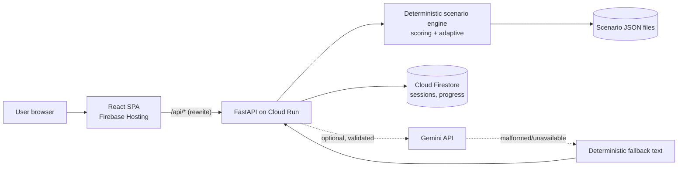

# ScamSim — Adaptive Financial-Scam Simulator

> **Learn to spot the scam before it costs you.**  
> An interactive fraud defense simulator placing users in authentic, pressured financial interactions (fake UPI payment screenshots, QR collect traps, bank impersonations) to build reflexes through consequence-free experience and personalized, adaptive learning.

---

## 1. Screenshots & Interface Preview

*(Visual evidence captured from local execution; replace placeholders with production screenshots upon public deployment)*

| View | Preview |
|---|---|
| **Landing Page** (`/`) |  |
| **Scenario Library** (`/library`) |  |
| **Interactive Simulation** (`/play/:id`) |  |
| **Scoring & Debrief** (`/results/:id`) |  |
| **Adaptive Defense Radar** (`/progress`) |  |

---

## 2. Technical Stack

* **Frontend**: React 19, TypeScript, Vite 6, Tailwind CSS v3, Lucide React, Vitest, Playwright E2E with `@axe-core/playwright`.
* **Backend**: FastAPI, Python 3.11, Pydantic v2 schemas (`extra="forbid"`), Uvicorn.
* **Storage & Persistence**: Google Cloud Firestore (Native mode, 30-day automated TTL) with automatic fallback to in-memory store for local execution.
* **Hosting & Compute**: Google Cloud Run (`scamsim-api` container) and Firebase Hosting with relative `/api/**` URL rewrites.
* **AI Engine (Optional / Fallback-Safe)**: Google Gemini API (`@google/genai`), server-side only for fresh phrasing variations with deterministic fallback.

---

## 3. Technical Architecture



| Service | Why Necessary | Behavior if Removed |
|---|---|---|
| **Cloud Run** | Hosts authoritative simulation engine, validation, and scoring logic. | No server-side scoring or anti-cheat validation. |
| **Cloud Firestore** | Persists session transitions, scores, and learner skill baselines across reloads. | Automatically falls back to in-memory store (`store: "memory"` in `/api/health`). |
| **Gemini API (Opt.)** | Generates dynamic phrasing variations for realistic unpredictability. | Seamlessly serves original authored scenario copy (`source: "fallback"`). |
| **Firebase Hosting** | Serves compiled static SPA bundle with atomic Cloud Run `/api/**` rewrites. | Requires separate frontend host and explicit CORS configuration. |

---

## 4. Environment Variables

### Backend (`backend/.env.example`)
| Variable | Default / Example | Purpose |
|---|---|---|
| `APP_ENV` | `dev` | Application runtime environment (`dev`, `prod`). |
| `ALLOWED_ORIGINS` | `http://localhost:5173,http://127.0.0.1:5173` | Allowed CORS origins for browser clients. |
| `STORE_BACKEND` | `memory` | Primary persistence backend (`memory` or `firestore`). |
| `GOOGLE_CLOUD_PROJECT` | `your-project-id` | Target Google Cloud Project ID for Firestore. |
| `FIRESTORE_DATABASE` | `(default)` | Firestore database name. |
| `GEMINI_ENABLED` | `false` | Enable or disable optional Gemini AI wording variations. |
| `GEMINI_API_KEY` | `your-gemini-api-key` | Google AI Studio Gemini API key (server-side only). |
| `GEMINI_MODEL` | `gemini-2.5-flash` | Gemini model name for server-side generation. |
| `SESSION_TTL_DAYS` | `30` | Retention window for session and progress documents. |
| `RATE_LIMIT_PER_MIN` | `60` | In-memory sliding window rate limit per client ID. |
| `LOG_LEVEL` | `INFO` | Logging level (`DEBUG`, `INFO`, `WARNING`, `ERROR`). |

### Frontend (`frontend/.env.example`)
| Variable | Default / Example | Purpose |
|---|---|---|
| `VITE_API_BASE_URL` | `/api` | Base URL prefix for backend REST requests. |
| `VITE_USE_MOCKS` | `false` | Toggle between mocked frontend fixture data and live API. |

---

## 5. Local Setup & Verification

### Prerequisites
* **Node.js** >= 20.x, **npm** >= 10.x
* **Python** 3.11+
* **Git**

### Installation

1. **Clone the repository:**
   ```bash
   git clone https://github.com/glider-vinnie/ScamSim.git
   cd ScamSim
   ```

2. **Backend Setup:**
   ```bash
   cd backend
   python -m venv .venv
   # Windows:
   .venv\Scripts\activate
   # macOS/Linux:
   # source .venv/bin/activate
   pip install -r requirements.txt
   cd ..
   ```

3. **Frontend Setup:**
   ```bash
   cd frontend
   npm install
   cd ..
   ```

### Running Locally

* **Terminal 1 — Backend:**
  ```bash
  cd backend
  .venv\Scripts\activate
  uvicorn app.main:app --port 8000
  ```

* **Terminal 2 — Frontend:**
  ```bash
  cd frontend
  npm run dev
  ```
  Open [http://localhost:5173](http://localhost:5173) in your browser.

---

## 6. Testing & Quality Assurance

```bash
# Backend pytest suite (80 tests)
cd backend && pytest -v && cd ..

# Frontend vitest unit suite (29 tests)
cd frontend && npm test && cd ..

# Frontend Playwright E2E suite (36 tests)
cd frontend && npx playwright test && cd ..

# Security bundle & secret leak check
node scripts/check-bundle.mjs

# WCAG design token contrast verification
cd frontend && npm run contrast && cd ..
```

---

## 7. Deployment Instructions

Deployment configuration files are pre-built:
* `backend/Dockerfile` (Python 3.11-slim, non-root `appuser`, uvicorn)
* `firebase.json` (SPA routing with `/api/**` rewrite to Cloud Run service `scamsim-api`)

Follow the complete step-by-step operator commands in [docs/DEPLOY_BLOCKERS.md](docs/DEPLOY_BLOCKERS.md).

---

## 8. Safety & Responsible AI Guarantees

* **Zero Real Transactions**: All interfaces display prominent `SIMULATION — NOT A REAL TRANSACTION` banners.
* **No Credential Harvesting**: The codebase strictly excludes PIN, OTP, password, card number, and banking input fields (enforced via `scripts/check-bundle.mjs`).
* **Non-Functional QR Codes**: Rendered QR representations are static SVG placeholder art containing zero machine-readable text or executable payment URIs.
* **Fictional Contexts**: All counterparty identities, bank names, and transaction IDs are completely fictional.
* **Guarded AI Generation**: Optional Gemini output is strictly confined to cosmetic conversational rephrasing, validated against brand blocklists and regex filters, and cannot alter decision trees, scoring, or red flag evaluations.

---

## 9. Current Status & Traceability

Status labels conform to the 6 official states: `Implemented`, `Tested locally`, `Tested deployed`, `Deployed`, `Planned`, `Blocked`.

| Capability / Requirement | Status | Verification Evidence |
|---|---|---|
| Deterministic simulation engine & graphs | **Tested locally** | 80/80 pytest (`backend/tests/test_engine.py`) |
| Authoritative server-side scoring | **Tested locally** | Pure formula tests (`backend/tests/test_engine.py`) |
| Adaptive learning & scenario recommendation | **Tested locally** | Recommendation matrix tests (`backend/tests/test_adaptive.py`) |
| Interactive simulation frontend | **Tested locally** | 29/29 Vitest + 36/36 Playwright E2E passing |
| WCAG Accessibility & contrast compliance | **Tested locally** | Zero serious/critical Axe violations; contrast script pass |
| Bundle safety & secret leak scanner | **Tested locally** | Clean run on `scripts/check-bundle.mjs` |
| Fallback-safe Gemini wording variations | **Tested locally** | Unit test suite (`backend/tests/test_ai.py`) |
| Containerized Dockerfile & Firebase config | **Implemented** | `backend/Dockerfile`, `firebase.json` present |
| Live GCP Cloud Run & Firebase Deployment | **Blocked** | Documented in `docs/DEPLOY_BLOCKERS.md` (CLI auth needed) |

---

## 10. Known Limitations

1. **Local Storage Session Identity**: Client IDs are pseudonymous UUIDv4 tokens stored in `localStorage`; authentication across multiple separate physical devices is currently **Planned**.
2. **Catalog Breadth**: The simulator currently contains three core scenarios: Fake Payment Screenshot, Refund QR Trap, and Urgent Bank Impersonation.
3. **In-Memory Rate Limiting**: The sliding-window rate limiter is per-instance; global distributed rate limiting via Redis is **Planned**.
4. **Cloud Deployment Execution**: Requires human operator execution with valid GCP credentials per [docs/DEPLOY_BLOCKERS.md](docs/DEPLOY_BLOCKERS.md).
