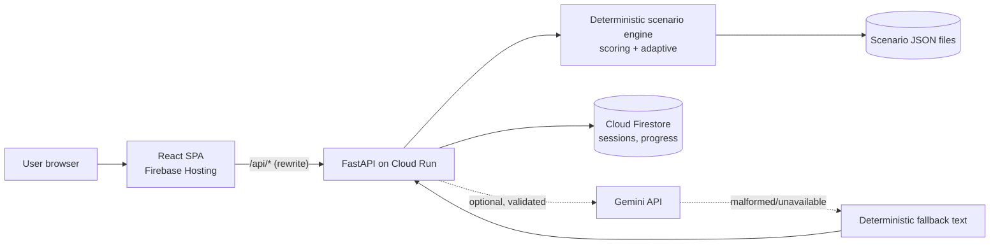

# SCAMSIM — MASTER PROMPT DOCUMENT

> **Status: SPECIFICATION ONLY.** Nothing here has been built, tested, deployed or evaluated. Status labels used everywhere: `Implemented` · `Tested locally` · `Deployed` · `Tested deployed` · `Planned` · `Blocked`.
> **Budget: 3 hours total.** Save this file in the repo as `docs/SCAMSIM_MASTER_PROMPT_DOCUMENT.md`. Antigravity reads only the sections it is pointed to (token optimisation).

---

## 1. Executive summary

ScamSim is a "flight simulator for financial scams": fictional, branching scam scenarios (UPI, QR, impersonation) where the user decides, sees consequences, learns red flags, and gets a **deterministically chosen follow-up** targeting their weakest skill.

- **Differentiator:** adaptive branching engine (deterministic, server-side) — not a chatbot.
- **Stack:** React+TS+Vite+Tailwind · FastAPI on **Cloud Run** · **Firestore** (sessions/progress) · Gemini (optional, validated, fallback) · Firebase Hosting (frontend).
- **Theme:** FinTech. **Tagline:** *Learn to spot the scam before it costs you.*
- **Priority:** Functionality (confirmed 40%) → one flawless end-to-end journey.

**3-hour reality check:** 15 prompts ≈ 8 min each if sequential. So: run prompts in **parallel lanes** (§17), merge early, deploy early, and use the **cut list** (§25) when behind. P10 (Gemini) is gated on P0 being finished.

---

## 2. Hackathon context & judging

**Event:** Digital Campus on Google Cloud Hack Sprint — Ramdeobaba University, powered by GeeksforGeeks. Themes: Healthcare, Smart Education, FinTech.

| Item | Status |
|---|---|
| Functionality = 40% | **Confirmed** (screenshot) |
| Other criteria & weights | **Unverified.** M4 must read the official page at T+0:00 and fix this table. |
| Guidance themes (working build, innovation, impact, meaningful Google Cloud, communication, early deploy, reliable demo) | From accompanying guidance; weights unknown |

**Provisional rubric (labelled provisional, no invented weights):** Functionality (40%, confirmed) · UX · Technical complexity · Innovation · Impact · Presentation · Google Cloud usage.

### Judging alignment matrix

| Criterion | Feature | Modules | Proving test | Evidence for judges | Risk / gap |
|---|---|---|---|---|---|
| **Functionality (40%)** | Full journey: library→play→results→follow-up | `engine.py`, `routes/*`, `PlayPage`, `ResultsPage` | pytest engine+API; Playwright journey (P11) | Live demo + `TEST_REPORT.md` | Deployed env differs from local; cold start |
| UX (prov.) | Design system, microcopy, responsive, a11y | `components/ui/*`, `copy.ts` | axe scan, keyboard test, contrast script | Mobile + desktop demo | Contrast on Teal/Coral text (§8) |
| Technical complexity (prov.) | Server-authoritative DAG engine, validation, idempotency | `engine.py`, `scoring.py`, `store.py` | Engine/API tests (§19) | Architecture diagram + test output | Time |
| Innovation (prov.) | Adaptive weakest-skill follow-up; visible recommendation change | `adaptive.py`, `ProgressPage` | Adaptive unit tests | Demo: poor run → replay rec; good run → new scenario | Only 3 scenarios limits variety |
| Impact (prov.) | Skill progress + missed-flag tracking | progress API, dashboard | Progress tests | Real evaluation data (§20) or "proposed" | Tiny sample; no real-world claims |
| Presentation (prov.) | 2–3 min scripted demo + backup video | `docs/DEMO_SCRIPT.md` | Timed rehearsal ×2 | Video file verified to open | Portal/Wi-Fi failure |
| Google Cloud (prov.) | Cloud Run + Firestore (+Gemini optional) | `Dockerfile`, `store.py`, `ai.py` | Deployed smoke test; Firestore doc seen in console | Console screenshots + public URL | Credentials/permissions blocker |

Rule: judged on **what works**, not feature count or services named.

---

## 3. Product vision & differentiator

ScamSim lets users *experience* fictional scams safely, make decisions, and improve through targeted practice. It is an educational simulator — not a bank, payment processor, fraud service, or advisor.

Differentiator: **adaptive, branching simulations that learn from decisions.** Engine is deterministic; AI only decorates (optional).

---

## 4. Problem & target users

**Hypothesis (not a statistic):** reading scam warning lists does not necessarily prepare people to recognise red flags inside a realistic, pressured interaction; practising decisions with immediate feedback may help. No market numbers or harm rates are claimed.

Primary: college students, first-time earners, young UPI users. Secondary: educators, campus cyber clubs, literacy workshops. No bank details, PINs, OTPs or real financial data are ever requested.

---

## 5. Product requirements

| ID | Requirement | Pri |
|---|---|---|
| R1 | Landing page: headline, explainer, CTAs "Start a simulation" / "How it works", sim preview, 3 steps, categories, fictional + no-real-payment disclaimer | P0 |
| R2 | Modes: Quick Play (P0), Practice (P0), Challenge (P2, shown as non-interactive "Coming soon") ; no auth; optional display name | P0 |
| R3 | Scenario library, 6 categories, cards show title/category/difficulty/duration/skills/SIMULATION label; category filter | P0 |
| R4 | 3 authored scenarios (§12.4) as JSON data, DAG, 2–4 choices, distinct outcomes | P0 |
| R5 | Per-decision feedback: what happened, red flags, why safer/riskier, safer alternative, what next; non-shaming | P0 |
| R6 | Results: decisions, caught/missed flags, score, skills, improve areas, follow-up, replay, disclaimer | P0 |
| R7 | Adaptive: 5 skills, deterministic updates + recommendation (§13) | P1 |
| R8 | Progress dashboard from stored sessions, empty states | P1 |
| R9 | Design system + exact palette, responsive, a11y | P0 |
| R10 | Safety rules (§15) | P0 |
| R11 | FastAPI backend validates everything server-side | P0 |
| R12 | Firestore persistence (memory fallback) | P1 |
| R13 | Gemini variations, optional | P2 |

Scenario categories (ids): `upi_request`, `fake_confirmation`, `qr_manipulation`, `impersonation`, `fake_offer`, `account_verification`. MVP scenarios cover `fake_confirmation`, `qr_manipulation`, `impersonation`; other categories appear in the filter with "No scenarios yet" empty state (honest, not faked).

---

## 6. User journey & information architecture

Landing → Mode → Library → Play → Feedback (per decision) → Results → Follow-up → Progress. No dead ends: every page offers a next action.

| Route | Page component | Purpose |
|---|---|---|
| `/` | `LandingPage` | Pitch, CTAs, `#how-it-works` anchor |
| `/library` | `LibraryPage` | Practice mode; scenario cards + category filter |
| `/play/:sessionId` | `PlayPage` | Simulation; resumable on refresh |
| `/results/:sessionId` | `ResultsPage` | Score, flags, follow-up, replay |
| `/progress` | `ProgressPage` | Skills, history, missed flags, next practice |
| `*` | `NotFoundPage` | Links home/library |

Quick Play = CTA on landing/mode picker → `POST /api/sessions` for `payment-screenshot` → `/play/:id`. Practice = `/library`. Replay = new session, same scenario.

---

## 7. Page-by-page UI/UX specification

**Landing:** NavBar (logo, Library, Progress). Hero: headline "Learn to spot the scam before it costs you.", 1-line explainer, primary "Start a simulation" (→ Quick Play), secondary "How it works" (scroll). Hero visual = static mock of a chat bubble + red-flag tag (real component reuse). Sections: 3 steps (Face it · Decide · Learn), 6 category chips, mode picker (Quick Play, Practice, Challenge-coming-soon), footer disclaimer. `SimulationBanner` on every page.

**Library:** heading, `CategoryFilter` (All + 6), grid of `ScenarioCard`. States: skeleton, error+retry, empty-category.

**Play:** top: `SimulationBanner`, step indicator ("Step 2 of ~3"), scenario title. Main: event area (renders by `eventType`: `chat`→`MessageBubble`, `payment_screenshot`→`PaymentScreenshotMock`, `qr_message`→`QrPlaceholder`, `call`/`sms`→`CallCard`, `pay_screen`→`PayScreenMock`, `app_view`→`AppViewMock`). Below: `ChoiceButton` list. After choice: `FeedbackPanel` (outcome, red flags caught ✓ / missed !, why, safer alternative, "Continue"). Terminal node: outcome card + "See results". No text inputs for PIN/OTP anywhere.

**Results:** `ScoreRing` + label, decisions timeline, flags caught/missed, skills moved, areas to improve, safe actions, follow-up card (with reason), buttons Replay / Library / Progress, "How scoring works" disclosure, disclaimer.

**Progress:** 5 `SkillBar`, scenarios completed, recent results (last 5), frequently missed flags, recommended next. Empty state: "No runs yet — try Quick Play" + CTA.

---

## 8. Color palette & design system

Exact brand colors (do not alter): **Navy #194777 · Teal #19869B · Mist #B2C8CA · Sand #EABD82 · Coral #E96532 · Berry #A92343.** Neutrals allowed: `--ink #0E1B2A`, `--muted #4A5B6B`, `--bg #F6F9F9`, `--surface #FFFFFF`.

| Token | Value | Use |
|---|---|---|
| `--color-bg` | #F6F9F9 | Page |
| `--color-surface` | #FFFFFF | Cards |
| `--color-surface-subtle` | Mist @ 25% on white | Panels |
| `--color-text` / `--color-text-muted` | ink / muted | Text |
| `--color-primary` / `-hover` | Navy / darker navy (#143A62) | Primary button, headings, nav |
| `--color-interactive` | Teal | Links-as-UI, active, progress fill, secondary-button border |
| `--color-border` | Mist | Borders/dividers |
| `--color-highlight` | Sand | Educational callouts (navy text on Sand) |
| `--color-warn` | Coral | Warning icons/borders |
| `--color-danger` | Berry | Critical; white text allowed |
| `--color-focus` | Teal, 3px ring + 2px offset | Focus |
| `--color-success` | Teal (with ✓ icon + text) | Success |
| `--shadow-card` | `0 1px 2px rgba(14,27,42,.06), 0 4px 12px rgba(14,27,42,.06)` | Cards |
| `--overlay` | ink @ 50% | Dialog scrim |
| Radii | 12px cards, 999px badges, 10px buttons | |

**Contrast rules (approximate, must be verified by `scripts/contrast.mjs`):** Navy/white ≈ 9:1 ✔; Berry/white ≈ 7:1 ✔; Navy on Sand ≈ 5.5:1 ✔; Navy on Mist ≈ 5.4:1 ✔; **Teal/white ≈ 4.3:1 ✘ for small text** → Teal only for UI parts (≥3:1), large/bold ≥18.66px text, never small body text; **Coral/white ≈ 3.3:1 ✘** → Coral only icons/borders/large shapes, text beside it in ink. Never Mist/Sand as small text on white.

**Risk badges (icon + text, never color alone):** Safe (Teal, `ShieldCheck`) · Cautious (Sand bg/navy text, `CircleAlert`) · Risky (Coral border, ink text, `TriangleAlert`) · Critical (Berry bg/white text, `OctagonAlert`).

**Type:** `@fontsource/plus-jakarta-sans` (headings), `@fontsource/inter` (body); base 16px, line-height 1.6. **Motion:** 150–250ms transitions; all disabled under `prefers-reduced-motion`. **Icons:** `lucide-react`.

**Component inventory:** `AppShell, NavBar, Button(primary|secondary|ghost), Card, Badge, RiskBadge, Dialog, Alert, ProgressBar, SkillBar, ScoreRing, SimulationBanner, ScenarioCard, CategoryFilter, MessageBubble, PaymentScreenshotMock, QrPlaceholder, CallCard, PayScreenMock, AppViewMock, ChoiceButton, FeedbackPanel, EmptyState, ErrorState, Skeleton`.

---

## 9. Microcopy & content guidelines

Single file `frontend/src/lib/copy.ts` holds all UI strings. Indian English ("practise", ₹, India-relevant fictional names). Tone: friendly, brisk, never shaming; safety instructions are plain and direct.

| Moment | Copy |
|---|---|
| Hero CTA | "Start a simulation" |
| Start | "Let's see if you catch the red flags." |
| Pressure scene | "That message wants you to panic. Don't let it rush you." |
| Safe choice | "You caught that one." |
| Risky choice | "Missed a red flag? That's literally what practice is for." |
| Screenshot lesson | "Plot twist: that payment screenshot proves nothing." |
| Rule of thumb | "Pause. Verify. Then decide." |
| Follow-up | "Your next scenario is based on what you missed." |
| Loss outcome | "In this simulation, that choice would have cost you ₹X. No real money moved." |
| Score note | "This score reflects how you did in this simulation. It doesn't guarantee how you'd handle a real scam." |
| Banner | "SIMULATION — fictional scenario. No real payments." |
| Payment mock | "SIMULATION — NOT A REAL TRANSACTION." |

Rules: use each example at most once per screen; ≤ 1 slang phrase per screen; "simulated loss", never "you lost money"; no brand names of real banks/apps.

---

## 10. Technical architecture



| Service | Why necessary | If removed |
|---|---|---|
| Cloud Run | Hosts authoritative engine/API; keeps scoring server-side | No trusted scoring; no deployed backend |
| Firestore | Sessions + skill progress persist across refresh/sessions | Falls back to in-memory: progress lost on restart |
| Gemini (opt.) | Wording variation only | Nothing breaks; static text used |
| Firebase Hosting | Serves SPA, same-origin `/api` rewrite (no CORS issues) | Use any static host + `ALLOWED_ORIGINS` |

**Repository layout**
```
scamsim/
  AGENTS.md  README.md  Makefile  .gitignore
  docs/                      (this doc, PLAN.md, TEST_REPORT.md, ...)
  frontend/  src/{pages,components/ui,components,lib/{api.ts,types.ts,copy.ts,clientId.ts},styles/tokens.css}
             scripts/{contrast.mjs,check-bundle.mjs}  e2e/
  backend/   app/{main.py,config.py,models.py,scenarios_loader.py,engine.py,scoring.py,
                  adaptive.py,store.py,ai.py,ratelimit.py,errors.py,routes/}
             scenarios/{payment-screenshot,refund-qr,urgent-bank-call}.json
             tests/  Dockerfile  requirements.txt
```

**Env vars (placeholders only)**
- Backend: `APP_ENV=dev|prod` · `ALLOWED_ORIGINS=<csv>` · `STORE_BACKEND=memory|firestore` · `GOOGLE_CLOUD_PROJECT=<id>` · `FIRESTORE_DATABASE=(default)` · `GEMINI_ENABLED=false` · `GEMINI_API_KEY=<secret>` · `GEMINI_MODEL=<verify current model name>` · `SESSION_TTL_DAYS=30` · `RATE_LIMIT_PER_MIN=60` · `LOG_LEVEL=INFO`
- Frontend: `VITE_API_BASE_URL=/api` · `VITE_USE_MOCKS=false`

**Local dev:** `make dev-be` (uvicorn :8000), `make dev-fe` (Vite :5173, proxy `/api`→8000), `make test`, `make lint`. Defaults: `STORE_BACKEND=memory`, Gemini off.

---

## 11. Data models & API contracts

Single schema, Pydantic (backend) mirrored in `frontend/src/lib/types.ts`. Authoritative copy lives in backend scenario JSON; frontend never holds answers.

```jsonc
// Scenario file (backend/scenarios/<id>.json)
{
  "id": "payment-screenshot", "title": "...", "category": "fake_confirmation",
  "difficulty": "easy|medium|hard", "estimatedDuration": 3,           // minutes
  "learningObjectives": ["..."], "startingContext": "...",
  "skills": ["payment_verification","urgency","safe_verification"],    // order: first = primary
  "redFlags": [{"id":"A-RF1","label":"...","explanation":"..."}],
  "startNodeId": "A1",
  "decisionNodes": [{
    "id":"A1", "terminal": false,
    "messageOrEvent": {"eventType":"chat|payment_screenshot|qr_message|call|sms|pay_screen|app_view|outcome",
                       "speaker":"Rohan K. (fictional)", "text":"...", "details":{"amount":"₹1,800","status":"Processing"}},
    "relevantSkills": ["payment_verification","urgency","safe_verification"],   // first = primary
    "redFlagsPresent": ["A-RF1","A-RF2","A-RF3"],
    "feedback": {"safeAlternative":"...", "considerNext":"..."},
    "choices": [{"id":"A1-a","label":"...","riskLevel":"safe|cautious|risky|critical",
                 "scoreDelta":2, "skillUpdates":{"payment_verification":10,"urgency":5,"safe_verification":5},
                 "nextNodeId":"A3", "catches":["A-RF1"],
                 "explanation":{"whatHappened":"...","why":"..."}}]
  }, {"id":"A-LOSS","terminal":true, "messageOrEvent":{"eventType":"outcome","text":"..."},
      "outcome":{"type":"loss|safe","title":"...","text":"..."}, "choices":[]}],
  "recommendedSafeActions": ["..."], "learningSummary": "..."
}
```
`nextNodeMapping` (spec field) = each choice's `nextNodeId`; `outcomes` = terminal nodes' `outcome`. Documented deviation, used everywhere.

**Skills (ids):** `urgency`, `impersonation`, `payment_verification`, `qr_collect`, `safe_verification` (fixed order shown).

```ts
Session { id, scenarioId, mode:"quick"|"practice"|"challenge", status:"in_progress"|"completed",
  startTime, completionTime|null, currentNodeId|null,
  decisions:[{nodeId, choiceId, riskLevel, scoreDelta, at}],
  score|null, identifiedRedFlags:string[], missedRedFlags:string[], skillUpdates:Record<Skill,number> }
UserProgress { sessionCount, completedScenarios:Record<scenarioId,count>, skillEstimates:Record<Skill,number>,
  recommendedNextScenario:{scenarioId,title,reason}|null,
  recentResults:[{sessionId,scenarioId,title,score,completedAt}] /*max 5*/, frequentlyMissedFlags:[{redFlagId,label,count}] }
PublicNode { id, event:{eventType,speaker?,text,details?}, choices:[{id,label}], progress:{step,estTotal}, terminal:boolean }
// PublicNode NEVER includes riskLevel/scoreDelta/catches (no answer leakage before deciding)
```

**Headers:** `X-Client-Id: <uuid v4>` required on all `/api/sessions*`, `/api/progress*`, `/api/ai/*`. Generated client-side, stored in `localStorage`. This is **pseudonymous ownership, not authentication** (documented limitation). Session ids = `secrets.token_urlsafe(16)`.

**Error body:** `{"error":{"code":"...","message":"..."}}` — codes: `SCENARIO_NOT_FOUND 404`, `SESSION_NOT_FOUND 404` (also returned for wrong owner), `CHOICE_INVALID 422`, `INVALID_TRANSITION 409`, `SESSION_COMPLETED 409`, `VALIDATION_ERROR 422`, `RATE_LIMITED 429`, `AI_UNAVAILABLE 503`, `STORE_UNAVAILABLE 503`.

| # | Endpoint | Request | Response |
|---|---|---|---|
| 1 | `GET /api/health` | – | `{status:"ok", store:"memory\|firestore\|memory-fallback", ai:"enabled\|disabled"}` |
| 2 | `GET /api/scenarios?category=` | – | `{scenarios:[{id,title,category,difficulty,estimatedDuration,skills,learningObjectives}]}` |
| 3 | `POST /api/sessions` | `{scenarioId, mode}` | `201 {session, node:PublicNode}` |
| 4 | `POST /api/sessions/{id}/decisions` | `{nodeId, choiceId}` | `{decision:{choiceId, riskLevel, scoreDelta, explanation:{whatHappened,why}, redFlagsCaught:[RedFlag], redFlagsMissed:[RedFlag], safeAlternative\|null, considerNext}, nextNode:PublicNode\|null, status, results?:Results}` |
| 5 | `POST /api/sessions/{id}/complete` | – | Idempotent finalise of a session already at a terminal node → `Results`; else `409 INVALID_TRANSITION` |
| 6 | `GET /api/sessions/{id}` | – | `{session, node:PublicNode\|null}` (refresh/resume) |
| 7 | `GET /api/sessions/{id}/results` | – | `Results` (409 if not completed) |
| 8 | `GET /api/progress` | – | `UserProgress` (empty-state defaults for new client) |
| 9 | `DELETE /api/progress` | – | `204`; deletes the client's sessions + progress |
| 10 | `POST /api/ai/variation` | `{scenarioId, nodeId}` | `{source:"gemini\|fallback", messageVariant, explanationVariant}` |

`Results = {sessionId, scenarioId, outcomeType, score, scoreLabel, decisionScore, flagScore, decisions[], identifiedRedFlags[], missedRedFlags[], skillUpdates, skillsDemonstrated[], areasToImprove[], learningSummary, recommendedSafeActions[], recommendedNext:{scenarioId,title,reason}|null}`.

Backend rules: validate scenario/choice ids; `nodeId` must equal `session.currentNodeId` else `409`; resubmitting the same `(nodeId, choiceId)` returns the stored response (idempotent); different choice for an already-answered node → `409`; scores/skills never accepted from client; unknown body fields rejected.

---

## 12. Scenario engine & scoring

### 12.1 Engine
Load JSON → validate (§12.5) → `start_session` → render `PublicNode` → `apply_decision` (validate → record → branch → feedback) → on terminal: finalise → `compute_results` → update progress (once). Pure functions in `engine.py`/`scoring.py`; no I/O.

### 12.2 Scoring (deterministic)
- `scoreDelta` by risk: **safe +2 · cautious +1 · risky 0 · critical −1**.
- `n` = decisions made. `decisionScore = round(100 × max(0, Σ scoreDelta) / (2n))`.
- Present flags = union of `redFlagsPresent` over **visited non-terminal nodes**. Caught = union of chosen choices' `catches` ∩ present. Missed = present − caught. `flagScore = round(100 × |caught| / |present|)` (100 if none present).
- **`score = round(0.7 × decisionScore + 0.3 × flagScore)`**.
- Label: ≥80 "Sharp eye" (ShieldCheck) · 50–79 "Getting there" (CircleAlert) · <50 "Needs practice" (TriangleAlert).
- Skill deltas per choice (authored per rule): primary skill = safe +10 / cautious +4 / risky −4 / critical −10; each secondary skill = trunc(primary/2). `skillUpdates` for a session = sum over decisions.

### 12.3 Outcome semantics
`loss` = simulated loss (copy: "In this simulation…"), `safe` = protected. Never imply a real transaction.

### 12.4 Authored scenarios (build exactly these graphs; write all prose in Indian-English, fictional)

**A `payment-screenshot`** — `fake_confirmation`, easy, 3 min. Context: you're selling a used scientific calculator on a campus marketplace; buyer "Rohan K." (fictional) says he paid ₹1,800, sends a screenshot (status "Processing", banner "SIMULATION — NOT A REAL TRANSACTION."), says his bus leaves in 5 minutes. Skills: `payment_verification`(primary), `urgency`, `safe_verification`.
Flags: A-RF1 screenshot ≠ proof of payment · A-RF2 urgency (bus leaving) · A-RF3 status says "Processing", not credited · A-RF4 pressure to skip checking your own account.

| Node (flags present) | Choice → next · risk · catches |
|---|---|
| **A1** [RF1,RF2,RF3] chat+screenshot | a "Hand it over — screenshot looks fine" → `A-LOSS` · critical · – <br> b "Check my own UPI app for the credit first" → `A3` · safe · RF1,RF3 <br> c "Ask him to resend the screenshot" → `A2` · risky · – |
| **A2** [RF2,RF4] buyer irritated, "my bank is slow" | a "Fine, take it" → `A-LOSS` · critical · – <br> b "Wait a few minutes, then check my own app" → `A3` · cautious · RF4 <br> c "Handover only once money shows in my account" → `A3` · safe · RF1,RF4 |
| **A3** [RF2,RF4] app view: no credit; buyer: "bank delays, trust me" | a "Hand over anyway" → `A-LOSS` · critical · – <br> b "Decline politely; offer to meet once payment shows" → `A-SAFE` · safe · RF2,RF4 <br> c "Decline, block and report buyer on the marketplace" → `A-REPORTED` · safe · RF2,RF4 |
Terminals: `A-LOSS` (loss), `A-SAFE` (safe), `A-REPORTED` (safe).

**B `refund-qr`** — `qr_manipulation`, medium, 3 min. Context: "FastCart Support" (fictional) messages that a ₹499 refund for a cancelled order will expire in 10 minutes; "scan this QR to receive it". QR is a **non-functional striped placeholder** labelled SIMULATION. Skills: `qr_collect`(primary), `urgency`, `safe_verification`.
Flags: B-RF1 unsolicited refund you didn't request · B-RF2 receiving money never needs scan/approval/PIN · B-RF3 expiry countdown pressure · B-RF4 request screen says PAY and amount mismatches (₹4,999).

| Node | Choice → next · risk · catches |
|---|---|
| **B1** [RF1,RF2,RF3] qr_message | a "Scan the QR to claim the refund" → `B2` · critical · – <br> b "Ask: why do I need to scan to receive money?" → `B3` · cautious · RF2 <br> c "Skip the QR; open the official app myself" → `B4` · safe · RF1,RF2,RF3 |
| **B2** [RF2,RF4] pay_screen "PAY ₹4,999 to refund-desk@sim" (simulated, no PIN field) | a "Approve — it's needed for the refund" → `B-LOSS` · critical · – <br> b "Stop. This says PAY, not RECEIVE. Cancel." → `B-CAUGHT-LATE` · safe · RF2,RF4 <br> c "Cancel and check the official app" → `B4` · safe · RF2,RF4 |
| **B3** [RF2,RF3] agent: "Just scan, expires in 10 minutes" | a "Okay, scanning" → `B2` · critical · – <br> b "Stop replying; check the official app" → `B4` · safe · RF3 |
| **B4** [RF1] app_view: no cancelled order, no refund pending | a "Block and report the sender" → `B-SAFE` · safe · RF1 <br> b "Just ignore it" → `B-IGNORED` · cautious · – |
Terminals: `B-LOSS` (loss), `B-CAUGHT-LATE` (safe), `B-SAFE` (safe), `B-IGNORED` (safe).

**C `urgent-bank-call`** — `impersonation`, medium, 3 min. Context: caller "Officer Mehta, Surya National Bank fraud desk" (**fictional bank**) says ₹24,000 suspicious debit; account blocks in 15 minutes unless "verified". Skills: `impersonation`(primary), `urgency`, `safe_verification`.
Flags: C-RF1 caller-initiated alarm about your account · C-RF2 authority + 15-minute block threat · C-RF3 asks for OTP · C-RF4 "stay on the line, tell no one".

| Node | Choice → next · risk · catches |
|---|---|
| **C1** [RF1,RF2] call | a "Answer questions and confirm my details" → `C2` · risky · – <br> b "I'll hang up and call the number on my card / official app" → `C3` · safe · RF1,RF2 <br> c "Hang up and ignore it" → `C-HANGUP` · cautious · RF2 |
| **C2** [RF2,RF3,RF4] sms (masked OTP "●●●●●●") + caller: "read it now, tell no one" | a "Read the OTP out" → `C-LOSS` · critical · – <br> b "Refuse to share the OTP and end the call" → `C3` · safe · RF3,RF4 <br> c "Say I'll call back after speaking to family" → `C3` · cautious · RF4 |
| **C3** [RF1,RF3] app_view: no alerts; official helpline says they never ask for OTP | a "Report the number via 1930 / cybercrime.gov.in" → `C-REPORTED` · safe · RF1,RF3 <br> b "Just block the number" → `C-SAFE` · cautious · – |
Terminals: `C-LOSS` (loss), `C-REPORTED` (safe), `C-SAFE` (safe), `C-HANGUP` (safe). *(Verify 1930 / cybercrime.gov.in on the official site before demo — assumption.)*

Each scenario also needs: `learningObjectives` (from §3.5 of the brief), `recommendedSafeActions` (≥3), `learningSummary`, per-node `feedback`, per-choice `explanation` (non-shaming).

### 12.5 Scenario validation (loader, tested)
Unique ids · `startNodeId` exists · every `nextNodeId` exists · acyclic · every node reaches a terminal · non-terminal has 2–4 choices · terminal has `outcome` and 0 choices · `catches ⊆ redFlagsPresent ⊆ redFlags` · at each node choices don't all share one `nextNodeId` · `skillUpdates` match §12.2 rule · content lint: no `http`, no 6+ digit runs, no real brand names (blocklist: SBI, HDFC, ICICI, Axis, Paytm, PhonePe, GPay, Google Pay, BHIM, NPCI, RBI, Amazon, Flipkart), confirmation nodes contain "SIMULATION — NOT A REAL TRANSACTION."

---

## 13. Adaptive learning

- Estimates: 5 skills, start **50**, clamp 0–100, updated **once at session completion** (idempotent) by `skillUpdates`.
- Scenario skill weight `w(s)`: mean over its non-terminal nodes of (1 if `s` is node primary, 0.5 if secondary, else 0).
- **Recommendation:**
  1. `weakest` = lowest estimate; ties → fixed order `urgency, impersonation, payment_verification, qr_collect, safe_verification`.
  2. Candidates = all scenarios ordered by `w(weakest)` desc, ties → fewest completions → id.
  3. Exclude the just-completed scenario **if its score ≥ 70** (variety); otherwise it stays eligible (targeted replay).
  4. First remaining candidate with `w>0` wins; reason string = "You're weakest at {skill label}; this one trains it."
  5. New user: recommend `payment-screenshot`.
- **Demo-able change:** poor run of A (e.g. A1-a) → payment_verification 40 = weakest → recommends **A (replay)**. Good run of A (A1-b, A3-b: pv 70, urgency 60, safe_verification 60) → weakest tie at 50 → impersonation → recommends **C**.
- No Gemini involvement.

---

## 14. Google Cloud integration plan

| Service | Role | Verification |
|---|---|---|
| Cloud Run `scamsim-api` | Hosts FastAPI; engine, validation, scoring | `curl <url>/api/health`; deployed smoke test |
| Firestore (Native) | `sessions/{id}` (clientId, status, decisions, results, `expiresAt`), `progress/{clientId}` (skillEstimates, counts, `recentResults`≤5, missedFlagCounts, `expiresAt`). No composite indexes needed. | Complete run → refresh → `/progress` unchanged; doc visible in console |
| Gemini (opt.) | Wording variants, server-side only | Unit tests with mocked client + one live call if key exists |
| Firebase Hosting | SPA + rewrite `/api/**`→Cloud Run | Public URL journey |

Setup (placeholders; human runs auth steps):
```
gcloud auth login && gcloud config set project <PROJECT_ID>
gcloud services enable run.googleapis.com firestore.googleapis.com cloudbuild.googleapis.com artifactregistry.googleapis.com
gcloud firestore databases create --location=<REGION>
gcloud firestore fields ttls update expiresAt --collection-group=sessions --enable-ttl
gcloud firestore fields ttls update expiresAt --collection-group=progress --enable-ttl
gcloud run deploy scamsim-api --source backend --region <REGION> --allow-unauthenticated \
  --set-env-vars APP_ENV=prod,STORE_BACKEND=firestore,GOOGLE_CLOUD_PROJECT=<PROJECT_ID>,GEMINI_ENABLED=false \
  --min-instances 0 --max-instances 3
# grant Cloud Run runtime service account: roles/datastore.user
# optional: Gemini key via Secret Manager --set-secrets GEMINI_API_KEY=<SECRET>:latest
firebase login && firebase init hosting && firebase deploy
```
**Cost/quota:** min-instances 0 → cold start (hit `/api/health` before demo; optionally min-instances 1 only during demo day); max-instances 3 caps spend; Firestore/Gemini free-tier limits must be **checked in current docs** (not assumed); set a billing budget alert. **Fallback:** Firestore init failure → log + memory store, `/api/health` shows `memory-fallback`. Gemini failure → fallback text.

---

## 15. Security & privacy

- **Never:** real payments, UPI PIN/OTP fields, bank credentials, functional QR codes, real links/malware, real people's data, real bank/app branding, sending sims to others.
- All sim visuals carry banner; QR = static SVG pattern with no encoded data (no QR library).
- Data collected: random client UUID, decisions, scores. Display name stays in browser only. Retention: 30 days (Firestore TTL + `SESSION_TTL_DAYS`); `DELETE /api/progress` deletes all. No analytics trackers.
- Server-side: Pydantic validation, `extra=forbid`, ownership checks (wrong owner → 404), idempotent transitions, in-memory per-client rate limit (documented: per-instance only), CORS allow-list, safe errors (no stack traces/secrets), structured logs with request id and no PII.
- Secrets only in env/Secret Manager; `.env` git-ignored; bundle scan test for key patterns.
- React escapes text; no `dangerouslySetInnerHTML`; AI output is plain text, length-capped, URL/number/brand filtered.

---

## 16. MVP scope & priorities

| P0 (must) | P1 | P2 (only after P0 works end-to-end) |
|---|---|---|
| Landing, library, 3 scenarios, engine, feedback, scoring/flags, results, responsive, tests, deployed app | Adaptive recs, Firestore persistence, Cloud Run, progress page | Gemini, Challenge mode, more scenarios, accounts, leaderboard, i18n |

---

## 17. Team & 3-hour schedule

| Member | Owns | Prompts |
|---|---|---|
| M1 — AI & content | Schema, scenarios, adaptive logic, Gemini | 04, 05*, 08 (logic), 10 |
| M2 — Backend & GCP | FastAPI, Firestore, Cloud Run | 01 (be), 09, 13 |
| M3 — Frontend & UX | Design system, pages | 01 (fe), 02, 03, 06, 07, 08 (UI) |
| M4 — QA & presentation | Verify rubric, tests, evaluation, docs, demo | 00, 11, 12 (triage), 14 |
(3 people: M4 merges into M1/M3. \*05 may be M2.) One shared repo from minute 0; merge to `main` at every checkpoint.

| Time | Activity |
|---|---|
| 0:00–0:10 | Create repo, add `AGENTS.md` (§18.0) + this doc; M4 verifies official rubric; M2 creates GCP project/APIs/billing alert. **P00** |
| 0:10–0:25 | **P01** (single agent, then everyone pulls) |
| 0:25–1:00 | Lane M3: **P02→P03** · Lane M1: **P04→P05** · Lane M2: **P09** (against §11 contract, engine imported when ready) · M4: eval sheet, consent text, demo script draft |
| 1:00–1:10 | **Checkpoint 1:** merge; **P13 EARLY mode** (hello-world deploy of FE+BE) |
| 1:10–1:40 | **P06→P07** (M3) · **P08** logic (M1) · P09 finish (M2) · wire frontend to real API |
| 1:40–2:00 | **Checkpoint 2:** full journey works locally. If yes and time: **P10**; else skip |
| 2:00–2:30 | **P11** → **P12** (feature freeze at 2:30) |
| 2:30–2:50 | **P13 FINAL**, **P14** (M4 starts docs earlier in parallel) |
| 2:50–3:00 | Rehearse demo ×2, verify backup video, buffer |

---

## 18. Antigravity prompts

### 18.0 One-time setup (human, before P00)
1. Put this document at `docs/SCAMSIM_MASTER_PROMPT_DOCUMENT.md`.
2. Save the block below as `AGENTS.md` in the repo root (assumption: Antigravity loads it as workspace rules; if not, paste it into a workspace rule/at the start of each session).
3. Mode tip (if available): Planning mode for P00/P09/P13; Fast mode for the rest.

````markdown
# AGENTS.md — ScamSim standing rules
Project: ScamSim, adaptive financial-scam simulator (hackathon, 3-hour build). Spec: docs/SCAMSIM_MASTER_PROMPT_DOCUMENT.md (read ONLY the sections a prompt cites).
Stack: frontend/ React+TS+Vite+Tailwind · backend/ FastAPI (Python 3.11) · Firestore · Cloud Run · Gemini optional.
Routes: / /library /play/:sessionId /results/:sessionId /progress. API prefix /api (spec §11). Header X-Client-Id (uuid v4).
Skills: urgency, impersonation, payment_verification, qr_collect, safe_verification.
Scoring: scoreDelta safe+2 cautious+1 risky0 critical-1; decisionScore=round(100*max(0,sum)/(2n)); flagScore=round(100*caught/present); score=round(.7*decision+.3*flag).
Palette (exact): Navy #194777, Teal #19869B, Mist #B2C8CA, Sand #EABD82, Coral #E96532, Berry #A92343 + neutrals in §8. Teal/Coral never small text.
RULES
1. Before editing: inspect the repo with targeted reads (list dirs, open only relevant files). Preserve working code; no rewrites of working files; no scope creep.
2. Safety: no real payments, no PIN/OTP inputs, no functional QR, no real links, no real brand names, no secrets in code/bundle. Every sim view shows SIMULATION labelling.
3. Server is authoritative for transitions, scores, skills. Frontend never computes or sends scores.
4. Use identical names for routes, components, fields and endpoints as the spec. Do not invent alternatives.
5. Tests: run only the tests relevant to the change plus a fast full run at the end. Never claim a pass you did not execute. Never fake data.
6. Token discipline: no re-printing whole files in chat, no repeating the spec, no long explanations, no unrequested docs.
7. REPORT FORMAT (≤15 lines): Done (bullets) · Files changed · Commands run + real result · Status label per item (Implemented/Tested locally/Planned/Blocked) · Unresolved issues.
````

---

### PROMPT 00 — Repository inspection and implementation plan
**Objective:** Establish what exists and produce a minimal plan. **No code changes.**
**Requirements:** all (planning). **Scope:** read-only except creating `docs/PLAN.md`.
**Standing:** Inspect the repo first; preserve everything; report honestly per AGENTS.md.
**Instructions:**
1. List top-level tree (depth 2). Detect existing frontend/backend, package managers, lockfiles, configs, tests, CI.
2. Run (if present) existing build/test commands; record real results. Run `node -v`, `npm -v`, `python --version`, `gcloud --version`, `firebase --version`; record missing tools.
3. Confirm `AGENTS.md` and `docs/SCAMSIM_MASTER_PROMPT_DOCUMENT.md` exist.
4. Write `docs/PLAN.md` (≤60 lines): current state, what works, gaps/prerequisites (accounts, billing, APIs, auth the human must do), and a mapping of P01–P14 → files to create/change, with risks.
**Files:** `docs/PLAN.md` only. **Depends on:** §18.0 done. **Constraints:** do not modify, delete or reformat any existing file; do not install packages.
**Acceptance:** PLAN.md exists; every claim about the repo is verified by a command or file read; missing prerequisites explicitly listed.
**Tests:** none. **Checklist:** ☐ no other file changed (`git status`) ☐ tool versions recorded ☐ blockers listed.
**Report:** per AGENTS.md.

---

### PROMPT 01 — Project setup and development tooling
**Objective:** Runnable monorepo skeleton with lint/format/test/dev scripts.
**Requirements:** R9, R11. **Scope:** tooling only; no features.
**Standing:** Inspect repo first; preserve working code; no unnecessary rewrites; report honestly.
**Instructions:**
1. `frontend/`: Vite + React + TypeScript (strict). Add Tailwind, `react-router-dom`, `lucide-react`, `@fontsource/plus-jakarta-sans`, `@fontsource/inter`, Vitest + `@testing-library/react` + `jsdom`, ESLint + Prettier. Vite dev proxy `/api` → `http://localhost:8000`. Create `src/{pages,components/ui,components,lib,styles}` and empty-but-valid `lib/{api.ts,types.ts,copy.ts,clientId.ts}`. `clientId.ts` exports `getClientId()` (uuid v4 in `localStorage`, try/catch).
2. `backend/`: `requirements.txt` (fastapi, uvicorn[standard], pydantic>=2, pydantic-settings, google-cloud-firestore, google-genai, pytest, httpx, ruff). Create `app/{main.py,config.py,errors.py}`; `config.py` reads env vars listed in spec §10 via pydantic-settings with safe defaults (`STORE_BACKEND=memory`, `GEMINI_ENABLED=false`). `main.py`: FastAPI app, CORS from `ALLOWED_ORIGINS`, `GET /api/health` → `{status,store,ai}`, JSON logging.
3. Root `Makefile`: `dev-fe`, `dev-be`, `test` (both), `lint` (both), `build-fe`. Root `.gitignore` (node_modules, dist, .venv, `.env*` except examples). `frontend/.env.example`, `backend/.env.example` with placeholders only.
4. One placeholder test per side (Vitest render of App; pytest for `/api/health`).
**Files:** as listed. **Depends on:** P00. **Constraints:** no secrets; no features; pin nothing exotic; no extra libraries.
**Acceptance:** `make dev-be` and `make dev-fe` start; `curl localhost:5173/api/health` returns JSON via proxy; `make lint` and `make test` exit 0.
**Tests:** the two placeholder tests. **Checklist:** ☐ TS strict on ☐ `.env` ignored ☐ proxy works ☐ scripts run.
**Report:** per AGENTS.md; include actual command outputs summary.

---

### PROMPT 02 — Design system and reusable components
**Objective:** Implement tokens and the full UI kit (spec §8).
**Requirements:** R9. **Scope:** `frontend/src/styles`, `components/ui`, `components` (presentational only; no data fetching).
**Standing:** Inspect repo first; preserve working code; no rewrites; report honestly.
**Instructions:**
1. `styles/tokens.css`: CSS variables exactly per §8 table (brand hex values exact). Map in `tailwind.config` (colors `navy, teal, mist, sand, coral, berry, ink, muted`, semantic tokens). Fonts via fontsource. Global focus ring (3px Teal + 2px offset), `prefers-reduced-motion` disables transitions/animations.
2. Build components from the §8 inventory in `components/ui/` (generic: `Button, Card, Badge, RiskBadge, Dialog, Alert, ProgressBar, SkillBar, ScoreRing, EmptyState, ErrorState, Skeleton, AppShell, NavBar`) and `components/` (domain: `SimulationBanner, ScenarioCard, CategoryFilter, MessageBubble, PaymentScreenshotMock, QrPlaceholder, CallCard, PayScreenMock, AppViewMock, ChoiceButton, FeedbackPanel`). Props typed; `RiskBadge` shows icon+text per §8. `PaymentScreenshotMock` always renders "SIMULATION — NOT A REAL TRANSACTION.". `QrPlaceholder` = static SVG pattern, no QR library, caption "Simulation — not scannable". `Dialog` traps focus, Esc closes, restores focus.
3. Dev-only route `/_kit` (guarded by `import.meta.env.DEV`) rendering every component in all states.
4. `frontend/scripts/contrast.mjs`: compute WCAG ratios for the token pairs actually used for text (≥4.5) and UI parts (≥3); print table; exit 1 on failure. Add npm script `contrast`.
5. Mobile-first responsive layout (works at 360px).
**Files:** listed. **Depends on:** P01. **Constraints:** no colors outside palette+neutrals; no color-only meaning; no gradients/glassmorphism/emoji; Teal/Coral never small text.
**Acceptance:** `/_kit` shows all components at 360px and 1280px; contrast script passes; keyboard focus visible on all interactive parts.
**Tests:** Vitest: `RiskBadge` renders text+icon per level; `PaymentScreenshotMock` contains simulation string; `QrPlaceholder` has no `<canvas>`/data attributes; `Dialog` focus trap/Esc; contrast script.
**Checklist:** ☐ tokens exact ☐ reduced-motion ☐ /_kit ☐ contrast passes ☐ no data fetching in components.
**Report:** per AGENTS.md.

---

### PROMPT 03 — Landing page, onboarding and scenario library
**Objective:** `/` and `/library` fully working with all states.
**Requirements:** R1, R2, R3. **Scope:** pages + `lib/api.ts` + `lib/copy.ts` + fixtures.
**Standing:** Inspect repo first; preserve working code; no rewrites; report honestly.
**Instructions:**
1. `lib/api.ts`: typed client for spec §11 (`getScenarios, startSession, submitDecision, getSession, getResults, getProgress, deleteProgress, getVariation`), base `VITE_API_BASE_URL`, adds `X-Client-Id`, parses `{error:{code,message}}` into `ApiError`. When `VITE_USE_MOCKS=true`, `getScenarios`/`startSession` use `lib/fixtures.ts` (3 scenario summaries; DEV only, clearly commented). `lib/types.ts` mirrors §11.
2. `lib/copy.ts`: all landing/library strings per §9.
3. `LandingPage` per §7: hero, primary CTA "Start a simulation" → calls `startSession({scenarioId:"payment-screenshot",mode:"quick"})` then navigates `/play/:id` (loading state on button; error `Alert` with retry), secondary CTA scrolls to `#how-it-works`; sim preview using real components; 3 steps; 6 category chips; mode picker (Quick Play, Practice → `/library`, Challenge = `aria-disabled` "Coming soon"); disclaimer; optional display name input (saved in `localStorage`, never sent).
4. `LibraryPage`: `CategoryFilter` (All + 6 ids), `ScenarioCard` grid (title, category, difficulty, duration, skills, SIMULATION label, "Start" → startSession mode `practice`). States: skeleton, error+retry, empty category ("No scenarios in this category yet"), empty library.
5. Router with `NotFoundPage`; `NavBar` links.
**Files:** `pages/{LandingPage,LibraryPage,NotFoundPage}.tsx`, `lib/*`, `App.tsx`. **Depends on:** P02. **Constraints:** no fake testimonials/stats; no sign-up gates; no dead-end buttons; no invented scenarios.
**Acceptance:** every CTA works (with mocks or backend); filter works; all four states reachable; fully usable at 360px.
**Tests (Vitest+RTL):** CTA click calls `startSession` and navigates; filter shows/hides cards; error state shows retry; empty state; Challenge not focusable-actionable; `ApiError` parsing.
**Checklist:** ☐ CTAs ☐ filter ☐ states ☐ mobile ☐ disclaimer visible ☐ copy only from `copy.ts`.
**Report:** per AGENTS.md.

---

### PROMPT 04 — Typed data models and three complete scenarios
**Objective:** Schemas, scenario JSON, validator, tests.
**Requirements:** R4, R5, R10. **Scope:** `backend/app/{models.py,scenarios_loader.py}`, `backend/scenarios/*.json`, `frontend/src/lib/types.ts`, tests.
**Standing:** Inspect repo first; preserve working code; no rewrites; report honestly.
**Instructions:**
1. `models.py` (Pydantic v2, `extra="forbid"`): Scenario, DecisionNode, Choice, RedFlag, Outcome, Session, Results, UserProgress, PublicNode, per spec §11 (field names exact). Mirror in `types.ts`.
2. Author `payment-screenshot.json`, `refund-qr.json`, `urgent-bank-call.json` **exactly following the graphs in spec §12.4** (node ids, choice ids, next nodes, risk levels, catches, flags). Write all prose: Indian-English, fictional names, non-shaming `explanation.whatHappened/why`, `feedback.safeAlternative/considerNext`, `learningObjectives`, ≥3 `recommendedSafeActions`, `learningSummary`. Fill `scoreDelta` and `skillUpdates` by the §12.2 rules (primary/secondary order from `relevantSkills`). Confirmation/screenshot nodes include "SIMULATION — NOT A REAL TRANSACTION." in `details.banner`.
3. `scenarios_loader.py`: `load_all()`, `get(id)`, with all §12.5 validations raising clear errors; startup fails fast on invalid data.
**Files:** as listed. **Depends on:** P01. **Constraints:** no real brands/links/6+digit numbers; do not change graph topology; no engine logic here.
**Acceptance:** loader loads 3 scenarios; every §12.5 rule enforced; best/worst paths exist per scenario.
**Tests (pytest):** each §12.5 rule has a passing and a failing fixture; per-scenario: all nodes reachable, ≥1 loss/safe terminal reachable as specified, branching not identical at each node, content lint passes, skill deltas follow rule table, flags subset rules.
**Checklist:** ☐ 3 JSON files ☐ topology matches §12.4 ☐ lint passes ☐ types mirror ☐ tests run & pass.
**Report:** per AGENTS.md.

---

### PROMPT 05 — Deterministic simulation engine
**Objective:** Pure, tested engine and scoring.
**Requirements:** R4, R5, R6, R11. **Scope:** `backend/app/{engine.py,scoring.py}`, tests. No HTTP, no I/O.
**Standing:** Inspect repo first (use P04 models/loader); preserve working code; no rewrites; report honestly.
**Instructions:** implement per spec §12.1–12.3:
- `start_session(scenario, client_id, mode) -> Session`; `public_node(scenario, node_id, step) -> PublicNode` (never leaks risk/score/catches).
- `apply_decision(session, scenario, node_id, choice_id) -> (Session, DecisionResult)` with checks: session in progress, `node_id == currentNodeId` else `InvalidTransition`, choice belongs to node else `ChoiceInvalid`; idempotent resubmit of identical `(nodeId, choiceId)` returns stored result; different choice for answered node → `InvalidTransition`. Computes `redFlagsCaught/Missed` for that node, `safeAlternative` (only if choice not safe), `considerNext`. On terminal next node: status `completed`, `completionTime`, results computed.
- `scoring.py`: `compute_results(session, scenario)` per §12.2 (decisionScore, flagScore, score, label, skillsDemonstrated = skills with Δ>0, areasToImprove = Δ≤0 with flag labels missed).
- Typed exceptions mapped later to error codes in §11.
**Files:** as listed. **Depends on:** P04. **Constraints:** pure functions, deterministic, no randomness, no time except injected clock; no client-supplied scores.
**Acceptance:** all three scenarios playable programmatically end-to-end; same inputs → identical outputs.
**Tests (pytest):** best path = 100 for A,B,C; worst path = 0; mixed-path hand-computed expectations for A (e.g. A1-c→A2-b→A3-b: Σ=0+1+2=3, n=3, decision=50; present RF1–4, caught RF4,RF2 (A2-b catches RF4; A3-b catches RF2,RF4) → 2/4=50; score=round(.7×50+.3×50)=50); invalid node/choice; replay-after-complete; idempotent duplicate; different-choice conflict; every choice in every scenario reaches a terminal; skill sums per §12.2; PublicNode has no `riskLevel`.
**Checklist:** ☐ pure ☐ tests include hand-computed cases ☐ exceptions typed ☐ no leakage.
**Report:** per AGENTS.md.

---

### PROMPT 06 — Interactive simulation interface
**Objective:** `/play/:sessionId` complete journey UI.
**Requirements:** R4, R5, R9, R10. **Scope:** `pages/PlayPage.tsx` + small hooks; use P02 components and P03 `api.ts`.
**Standing:** Inspect repo first; preserve working code; no rewrites; report honestly.
**Instructions:**
1. On mount `getSession(sessionId)` → render `node` (resume after refresh). Render by `event.eventType` (§7 mapping). Show `SimulationBanner`, step indicator (`progress.step`/`estTotal`), scenario title.
2. Choices as `ChoiceButton`s (radio-like, keyboard operable). On select: disable all choices + show pending; `submitDecision({nodeId, choiceId})`; show `FeedbackPanel`: outcome text (`whatHappened`), `RiskBadge`, red flags caught (✓) and missed (!) with labels/explanations, `why`, `safeAlternative` when present, `considerNext`; "Continue" advances to `nextNode`.
3. Terminal node: outcome card (loss framed as "simulated loss"); CTA "See results" → `/results/:id`. Always-available "Restart" (new session same scenario, confirm `Dialog`) and "Library".
4. Errors: 409/422 → `Alert` with "Reload scenario" (re-fetch session); network → retry; invalid sessionId → `ErrorState` with link to library.
5. Move focus to `FeedbackPanel` heading after decision; announce via `aria-live="polite"`.
**Files:** `PlayPage.tsx`, `lib/useSession.ts`. **Depends on:** P02, P03, P09 (or mocks for UI; final wiring after P09). **Constraints:** no PIN/OTP/text inputs; frontend never computes score; ignore double-clicks; no leaking correct answers pre-decision.
**Acceptance:** all 3 scenarios completable with real backend; refresh mid-scenario resumes same node; restart/replay works; mobile 360px usable.
**Tests (Vitest/RTL, mocked API):** renders each eventType; decision flow; double-click sends one request; 409 handling; resume; terminal CTA; restart dialog; aria-live region present.
**Checklist:** ☐ eventTypes ☐ resume ☐ focus mgmt ☐ errors ☐ no input fields for credentials.
**Report:** per AGENTS.md.

---

### PROMPT 07 — Scoring, red-flag tracking and results
**Objective:** `/results/:sessionId` page.
**Requirements:** R6, R10. **Scope:** `pages/ResultsPage.tsx`; backend `GET /results` shape already defined (P09 wires it).
**Standing:** Inspect repo first; preserve working code; no rewrites; report honestly.
**Instructions:**
1. Fetch `getResults(sessionId)` (409 → redirect to `/play/:id`). Render: `ScoreRing` + label (icon+text), decisions timeline (choice label + `RiskBadge`), caught/missed flags with explanations, skills demonstrated (Δ shown), areas to improve, `learningSummary`, `recommendedSafeActions`, follow-up card from `recommendedNext` (title + reason + "Start this" → startSession practice) — hidden with neutral fallback ("See library") if null, Replay (new session same scenario), Library, Progress.
2. "How scoring works" disclosure showing the §12.2 formula in plain language + disclaimer from §9. Loss outcomes use "simulated" wording.
3. Loading skeleton, error + retry, not-found states.
**Files:** `ResultsPage.tsx`. **Depends on:** P05, P06, (P08/P09 for `recommendedNext`). **Constraints:** display only server values; no recomputation; no claims about real-world immunity.
**Acceptance:** results match the stored session exactly; all buttons work; replay creates a new session.
**Tests:** renders from fixture Results (best, worst, mixed); null `recommendedNext`; 409 redirect; disclaimer present; Replay calls `startSession`.
**Checklist:** ☐ caught vs missed ☐ formula shown ☐ disclaimer ☐ states ☐ no dead end.
**Report:** per AGENTS.md.

---

### PROMPT 08 — Adaptive learning and progress dashboard
**Objective:** Skill estimates, recommendation, `/progress`.
**Requirements:** R7, R8. **Scope:** `backend/app/adaptive.py` (pure) + `pages/ProgressPage.tsx`.
**Standing:** Inspect repo first; preserve working code; no rewrites; report honestly.
**Instructions:**
1. `adaptive.py` per spec §13: `initial_progress()`, `apply_session(progress, results, scenario)` (idempotent via `lastSessionId` set check; updates estimates clamp 0–100, `sessionCount`, `completedScenarios`, `missedFlagCounts`, `recentResults` max 5), `scenario_weights(scenario)`, `recommend(progress, scenarios, last_scenario_id, last_score)` returning `{scenarioId,title,reason}`.
2. `ProgressPage`: 5 `SkillBar`s with text values, scenarios completed, recent results (links to results), frequently missed flags (top 5), recommended next (Start button). Empty state for new client ("No runs yet" + Quick Play CTA). Skeleton/error states. "Delete my data" button → `Dialog` → `deleteProgress()`.
3. Aggregation uses only stored data; no sample data.
**Files:** `adaptive.py`, `ProgressPage.tsx`. **Depends on:** P04, P05; endpoint wiring in P09. **Constraints:** deterministic; no Gemini; no invented stats.
**Acceptance:** recommendation rules exactly per §13, including the two demo cases.
**Tests (pytest):** new user → `payment-screenshot`; poor A (A1-a path) → recommends A; good A → recommends C; tie-break order; just-completed excluded when score ≥70 and eligible when <70; idempotent re-apply; clamps; recentResults cap; weights computed from §12.4 (e.g. `w(payment_verification)` A=1, B=0, C=0). Vitest: empty state, populated state, delete flow.
**Checklist:** ☐ both demo cases pass ☐ idempotent ☐ empty state ☐ delete.
**Report:** per AGENTS.md.

---

### PROMPT 09 — Backend, persistence and API contracts
**Objective:** Full FastAPI API per §11 with persistence.
**Requirements:** R11, R12. **Scope:** `backend/app/{routes/*,store.py,ratelimit.py,errors.py,main.py}`, frontend switch to real API.
**Standing:** Inspect repo first (reuse P04/P05/P08 modules); preserve working code; no rewrites; report honestly.
**Instructions:**
1. Implement endpoints 1–10 of §11 (10 returns fallback until P10). Require valid UUIDv4 `X-Client-Id` on session/progress/ai routes (`VALIDATION_ERROR` otherwise). Ownership: wrong owner → `SESSION_NOT_FOUND`.
2. `store.py`: `Store` protocol (`get_session, put_session, get_progress, put_progress, delete_client`), `MemoryStore`, `FirestoreStore` (collections `sessions`, `progress`; `expiresAt = now + SESSION_TTL_DAYS`; no composite indexes). Session finalisation updates progress exactly once (use Firestore transaction/ idempotency check). Startup: if `STORE_BACKEND=firestore` and init fails → log error, use `MemoryStore`, health reports `memory-fallback`.
3. `errors.py`: exception→`{error:{code,message}}` mapping per §11; never leak stack traces. `ratelimit.py`: in-memory per-client sliding window (`RATE_LIMIT_PER_MIN`). Structured logs with request id; no PII.
4. `POST /sessions/{id}/complete` and `GET /results` semantics exactly per §11; `recommendedNext` filled via `adaptive.recommend`.
5. Frontend: set `VITE_USE_MOCKS=false` default; ensure P03/P06/P07/P08 pages work with the real API.
**Files:** as listed. **Depends on:** P04, P05, P08 logic. **Constraints:** never trust client scores/skills; reject unknown fields; do not log secrets; no cloud calls in unit tests (use `MemoryStore` + fake Firestore client).
**Acceptance:** full journey works in browser against local backend; refresh persists; `STORE_BACKEND=firestore` works when credentials exist (else documented `Blocked`).
**Tests (pytest + TestClient):** each endpoint happy path; invalid scenario/choice/UUID; wrong owner; invalid transition; duplicate submit idempotent; different-choice conflict; completed-session decision; results before completion 409; progress updated once after double `/complete`; delete removes data; rate limit 429; Firestore-unavailable fallback; error body shape; store contract tests run against both stores (Firestore against fake/emulator, mark `Planned` if emulator unavailable).
**Checklist:** ☐ 10 endpoints ☐ ownership ☐ idempotency ☐ fallback ☐ real FE journey.
**Report:** per AGENTS.md.

---

### PROMPT 10 — Optional Gemini integration (GATED)
**Gate:** run only if P0 journey works end-to-end locally. Otherwise skip and mark `Planned`.
**Objective:** Server-side, validated, fallback-safe wording variations.
**Requirements:** R13. **Scope:** `backend/app/ai.py`, `routes/ai.py`, small optional FE toggle.
**Standing:** Inspect repo first; preserve working code; no rewrites; report honestly.
**Instructions:**
1. `ai.py` using `google-genai`; model from `GEMINI_MODEL` (check current model name in official docs; do not hardcode guesses); key from `GEMINI_API_KEY`; enabled only if `GEMINI_ENABLED=true` and key present. Request JSON via response schema `{messageVariant:str(<=400), explanationVariant:str(<=400)}`; prompt includes the original node text and instruction to rewrite wording only, same facts, same red flags, fictional, no URLs/numbers/brands.
2. Validate with Pydantic + safety filters: length, no URLs, no 5+ digit runs, no brand blocklist (§12.5), no markup/HTML, non-empty. Timeout 8s. On disabled/timeout/error/malformed/blocked → return `source:"fallback"` with original node text (HTTP 200). Cache in-process by `(scenarioId,nodeId)` (TTL 1h). Stricter rate limit (10/min/client).
3. `POST /api/ai/variation` per §11. AI output **never** touches choices, ids, scores, skills, transitions or outcomes.
4. FE: optional "Fresh wording" toggle on `PlayPage` that swaps the event text with an "AI-varied wording" tag; default off; app unchanged if endpoint returns fallback.
**Files:** as listed. **Depends on:** P09. **Constraints:** key never in frontend or logs; no executing generated content; app fully works with Gemini disabled.
**Acceptance:** disabled → fallback 200; enabled+mock valid → `gemini`; all failure modes → fallback.
**Tests (pytest, mocked client):** valid; malformed JSON; schema violation; too long; URL present; digit run; brand; timeout; exception; cache hit; disabled flag; no key; rate limit. If no real key/quota: state `Blocked` for live call and `Tested locally (mocked)` for the rest.
**Checklist:** ☐ fallback always ☐ no secrets in bundle ☐ scores untouched ☐ honest status.
**Report:** per AGENTS.md.

---

### PROMPT 11 — Accessibility, responsive design, security and integration testing
**Objective:** Find defects with real tests. **Report only; do not fix** (P12 fixes).
**Requirements:** §8 of spec. **Scope:** `frontend/e2e/`, `scripts/check-bundle.mjs`, `docs/TEST_REPORT.md`.
**Standing:** Inspect repo first; preserve working code; no rewrites; report honestly.
**Instructions:**
1. Add Playwright + `@axe-core/playwright`. Specs: (a) full journey for each of the 3 scenarios (best and loss path) via UI, at desktop 1280 and mobile 375; (b) refresh mid-scenario; (c) restart/replay; (d) recommendation changes (poor A → A, good A → C) using a fresh client each; (e) keyboard-only run of Quick Play; (f) `prefers-reduced-motion: reduce` check (no animations); (g) axe scan on `/`, `/library`, `/play/*`, `/results/*`, `/progress` (fail on serious/critical); (h) offline/500 simulations via route interception → error UIs; (i) backend down → friendly state.
2. Backend negative tests (pytest or curl script): invalid scenario/choice IDs, invalid transition, repeated submissions, missing/invalid `X-Client-Id`, oversize body, unknown fields, Firestore-unavailable fallback (simulated), Gemini disabled/unavailable, missing env vars.
3. `scripts/check-bundle.mjs`: scan `frontend/dist` for `AIza`, `GEMINI`, `PRIVATE KEY`, `.env` strings; fail if found. Grep confirms no PIN/OTP inputs (`type="password"`, `inputmode="numeric"`, labels "PIN"/"OTP" in inputs) and no `dangerouslySetInnerHTML`.
4. Run `contrast` script. Write `docs/TEST_REPORT.md`: table of each test → real result (Pass/Fail/Not run + why), defects with severity (P0 blocks journey / P1 / P2) and repro steps.
**Files:** as listed. **Depends on:** P01–P09 (P10 if built). **Constraints:** never mark Pass unless executed; do not modify product code.
**Acceptance:** `TEST_REPORT.md` reflects actual runs; every failure has repro.
**Tests:** the above. **Checklist:** ☐ 3 scenarios ×2 viewports ☐ axe ☐ bundle scan ☐ negatives ☐ honest report.
**Report:** per AGENTS.md.

---

### PROMPT 12 — Defect fixing and regression testing
**Objective:** Fix confirmed defects from `docs/TEST_REPORT.md`, nothing else.
**Standing:** Inspect repo first; preserve working code; no rewrites; report honestly.
**Instructions:**
1. Read only `docs/TEST_REPORT.md`. Fix in order: P0 → P1 → P2 until time-box (25 min) ends; skip P2 if needed.
2. Per defect: minimal change, add/adjust a regression test that fails before and passes after (record both).
3. Re-run only affected tests, then the full `make test` + Playwright suite once at the end.
4. Append a before/after table to `TEST_REPORT.md` (defect, fix summary, before result, after result, still-open).
**Constraints:** no new features; no refactors; no dependency churn; do not weaken tests to pass.
**Acceptance:** all P0 defects fixed with passing regression tests, or listed as `Blocked` with reason.
**Checklist:** ☐ before/after recorded ☐ full suite re-run ☐ open issues listed.
**Report:** per AGENTS.md.

---

### PROMPT 13 — Production build and Google Cloud deployment
**Modes:** **EARLY** (T+1:00; deploy skeleton to prove pipeline) and **FINAL** (T+2:30; deploy full app). State which mode you are running.
**Objective:** Real public deployment, verified.
**Requirements:** R11, R12, §14.
**Standing:** Inspect repo first; preserve working code; no rewrites; report honestly.
**Instructions:**
1. Check auth: run `gcloud auth list`, `gcloud config get-value project`, `firebase projects:list`. If not logged in, **stop and give the human the exact commands** (never invent project ids, never attempt interactive login).
2. `backend/Dockerfile` (python:3.11-slim, non-root, `uvicorn app.main:app --host 0.0.0.0 --port $PORT`), `.dockerignore`. Ensure scenarios JSON is copied.
3. Execute §14 commands with real project/region: enable APIs, create Firestore (if absent), TTL policies, deploy `scamsim-api` with env `STORE_BACKEND=firestore`, `GEMINI_ENABLED=false` (true only if P10 done and secret configured via Secret Manager), grant `roles/datastore.user` to the runtime service account.
4. Frontend: `VITE_API_BASE_URL=/api npm run build`; run `scripts/check-bundle.mjs`; `firebase.json` with SPA fallback + rewrite `/api/**` → Cloud Run `scamsim-api` (region); deploy hosting.
5. Verify (record real output): `curl <host>/api/health` shows `store:"firestore"`; run Playwright journey against the public URL (`BASE_URL`); complete a session, reload, confirm `/progress` persisted; confirm a `sessions` doc exists (console/gcloud). EARLY mode: health + landing page load only.
6. If anything is blocked, write `docs/DEPLOY_BLOCKERS.md` (exact error, missing permission, remaining commands). Update `README` placeholders only with verified URLs.
**Files:** `backend/Dockerfile`, `.dockerignore`, `firebase.json`, `.firebaserc`, `docs/DEPLOY_BLOCKERS.md` (if needed). **Depends on:** P09 (+P11/P12 for FINAL). **Constraints:** no secrets committed; do not claim deployed/verified without evidence; `--allow-unauthenticated` only for this public demo API.
**Acceptance:** public URL loads; full journey passes on deployed URL; Firestore persistence confirmed — or exact blocker documented.
**Tests:** the verification steps above. **Checklist:** ☐ health ☐ journey on public URL ☐ Firestore doc seen ☐ bundle clean ☐ statuses honest (`Deployed` vs `Tested deployed`).
**Report:** per AGENTS.md, with public URL only if verified.

---

### PROMPT 14 — Demo, documentation and submission readiness
**Objective:** Documentation and evidence pack. **Docs only; no feature code.**
**Standing:** Inspect repo first; preserve working code; no rewrites; report honestly.
**Instructions:** Create/verify, concisely, using only verified facts:
1. `README.md`: what/why, FIJ screenshot placeholders for the human, stack, architecture Mermaid (from spec §10), local setup, env var table (from `.env.example`), commands, deployment steps, safety notes, limitations, status table using the 6 status labels.
2. `docs/API.md` (endpoints/errors from §11, verified against code), `docs/ARCHITECTURE.md`, `docs/EVALUATION.md` (protocol §20; results section filled **only** from real data, else "Proposed — not run"), `docs/DEMO_SCRIPT.md` (§21 + Q&A), `docs/BACKUP_RECORDING.md` (checklist: record deployed demo, ≤3 min, play-test file opens, saved on 2 devices).
3. `docs/TRACEABILITY.md`: matrix per criterion → implementation → test → evidence → status, derived from `TEST_REPORT.md`; unverified = `Planned`/`Blocked`, never "complete".
4. `docs/SUBMISSION_CHECKLIST.md` from §24. Confirm `.env.example` has placeholders only.
**Constraints:** do not invent users, metrics, costs, competitors, test results or URLs; cite file/test names as evidence.
**Acceptance:** every statement traceable to code, a test result or marked Planned.
**Tests:** run README setup commands in a clean clone if time permits (record result); link-check docs.
**Checklist:** ☐ no fabricated claims ☐ statuses match TEST_REPORT ☐ placeholders flagged.
**Report:** per AGENTS.md.

---

## 19. Functional & security testing plan

| ID | Test | Layer | Expect |
|---|---|---|---|
| T1 | Load all 3 scenarios + §12.5 validators | pytest | pass/fail fixtures behave |
| T2 | Best/worst/mixed path scores | pytest | 100 / 0 / hand-computed |
| T3 | Invalid scenario/choice/transition, duplicate, conflict | pytest API | 404/422/409 / idempotent |
| T4 | Ownership + missing X-Client-Id | pytest API | 404 / 422 |
| T5 | Recommendation changes (poor A→A, good A→C) | pytest + E2E | as §13 |
| T6 | Journey ×3 scenarios, desktop+mobile | Playwright | completes, results match |
| T7 | Refresh mid-scenario, restart, replay | Playwright | resumes / new session |
| T8 | Firestore persistence (local creds / deployed) | manual + script | progress survives reload |
| T9 | Firestore down → fallback | pytest | `memory-fallback`, app works |
| T10 | Gemini off / malformed / timeout | pytest | fallback 200 |
| T11 | Bundle secret scan; no PIN/OTP inputs; no `dangerouslySetInnerHTML` | script | clean |
| T12 | Error messages leak nothing | pytest | generic bodies |
| T13 | Keyboard-only; focus visible; axe; contrast; reduced motion; 360px | Playwright + script | no serious violations |
| T14 | Empty library / missing fields / network error UIs | Vitest/Playwright | states render |
| T15 | Deployed smoke | Playwright vs public URL | journey passes |

Reporting uses the six status labels; nothing is "Pass" unless executed.

---

## 20. Impact evaluation protocol (define before running)

- **Sample:** target 5–8 consenting peers (target only; report actual *n*). 10-minute session: Quick Play → one more scenario → 3-question survey. Consent line shown verbally; no personal data collected; data = server session records.
- **Metrics & formulas (fixed now):**
  1. Completion rate = completed sessions / started sessions.
  2. Red-flag identification = Σ caught / Σ present across completed sessions (first attempts only).
  3. Targeting accuracy = % of recommendations whose recommended scenario has `w(weakest)>0` for that user's lowest skill at recommendation time (deterministic audit; expect 100%, report any miss).
  4. Task time = `completionTime − startTime` (median, per scenario).
  5. Usability = mean 1–5 on: "instructions were clear", "scenario felt realistic", "I'd check payments differently now" (self-report, not behaviour).
  6. Observed failures = list of bugs/confusions seen.
  7. Improvement (descriptive only): for users who replay a targeted scenario, safe-choice rate first vs second attempt. No significance claims.
  8. Gemini content correctness (only if enabled): manually review all variants shown; % retaining original red flags and facts.
- **Reporting:** actual *n*, raw numbers, limitations (small sample, peers, self-report, short horizon). If not run: label "Proposed — not run". Never claim real-world immunity, savings or market numbers.

---

## 21. Demo & presentation script (~2:45)

| Time | Screen | Say |
|---|---|---|
| 0:00–0:15 | Landing | One-line problem + hypothesis: "Reading warning lists isn't the same as deciding under pressure." |
| 0:15–0:45 | Quick Play → scenario A | Fictional buyer + screenshot; point to SIMULATION label |
| 0:45–1:15 | Choose "Hand it over" | Feedback: red flags, simulated loss, safer alternative |
| 1:15–1:35 | Replay branch, choose "Check my own app" | Different branch, different outcome |
| 1:35–2:00 | Results | Score formula is rule-based, not AI; caught vs missed |
| 2:00–2:20 | Recommendation / Progress | Skill estimates; show rec changed (poor→replay vs good→impersonation) |
| 2:20–2:45 | Cloud console/diagram | Cloud Run engine, Firestore doc, Gemini optional (state its real status); evaluation evidence if collected |

**Q&A (answer only with verified facts):**
- *What's working?* → read from `TRACEABILITY.md`.
- *Different from existing tools?* → interactive branching + adaptive follow-up; don't name competitors we haven't verified.
- *Why these services?* → §10 table.
- *Gemini unavailable?* → fallback text, scoring unaffected.
- *Scoring?* → §12.2, show formula.
- *Adaptive?* → §13: weakest skill → weighted scenario.
- *Evaluated how?* → §20, actual n, limits.
- *Scale?* → Cloud Run autoscaling, Firestore; limits: per-instance rate limiter, pseudonymous client id (planned: auth).
- *Limitations?* → §25.
- *How much built in the hackathon?* → everything (state any pre-existing code honestly).

Backup: record the deployed demo; verify the file opens on the presenting laptop and phone.

---

## 22. README & deployment requirements

README must contain: pitch, status table (6 labels), screenshots (human adds), stack, Mermaid diagram, local setup (`make dev-be`, `make dev-fe`), env table, test commands, deployment steps (§14), API summary link, safety notes, privacy/retention, limitations, team, license placeholder. Deployment must be reproducible from the README with placeholders only.

---

## 23. Final judging traceability matrix (fill in P14 from real results)

| Criterion | Implementation | Test | Evidence | Status |
|---|---|---|---|---|
| Functionality (40%, confirmed) | engine, routes, pages | T2,T3,T6,T7,T15 | TEST_REPORT, live demo | Planned |
| UX | design system, copy | T13,T14 | axe + contrast output | Planned |
| Technical complexity | server-authoritative DAG, idempotency | T1–T4 | pytest output | Planned |
| Innovation | adaptive recommendation | T5 | demo of changing rec | Planned |
| Impact | progress + evaluation | T8, §20 | EVALUATION.md | Planned |
| Presentation | script + video | rehearsals | video file | Planned |
| Google Cloud | Cloud Run, Firestore, (Gemini) | T8,T15 | console screenshots | Planned |
(Provisional rows except Functionality. Update statuses only from executed tests.)

---

## 24. Submission readiness checklist

☐ Official rubric verified & §2 corrected ☐ Public URL works from another device ☐ Journey passes on deployed URL ☐ Firestore doc visible ☐ No secrets in repo/bundle ☐ README + docs complete ☐ TEST_REPORT honest ☐ Traceability filled ☐ Evaluation reported with real n or marked proposed ☐ Backup video opens ☐ Demo rehearsed ×2 ☐ Portal submission done early (leave 10-minute buffer) ☐ Team can answer §21 Q&A.

---

## 25. Assumptions, limitations, contingencies

**Assumptions (unverified):** Antigravity reads `AGENTS.md`; team has a GCP project with billing and Firebase access; Gemini key/quota may be unavailable; helplines/URLs in scenario C are accurate (verify); Python 3.11 and Node LTS available; Firebase Hosting rewrite to Cloud Run is permitted in the project.

**Limitations:** only 3 scenarios; pseudonymous client id (not auth); per-instance rate limiter; scores measure simulation performance only; small evaluation sample; English only.

**Cut list (apply in order when behind):**
1. Skip P10 (Gemini) → mark `Planned`.
2. Skip Firestore: `STORE_BACKEND=memory`, state honestly (health shows `memory`).
3. Drop Practice filter polish (keep list).
4. Drop Playwright suites except journey (a) + axe.
5. Skip evaluation → present protocol as "Proposed".
6. If Cloud Run deploy blocked: deploy both to a local tunnel/other host, document in `DEPLOY_BLOCKERS.md`, demo from backup video.

**Never cut:** safety rules, server-side validation, SIMULATION labelling, the 3 scenarios, results page, honest reporting.
