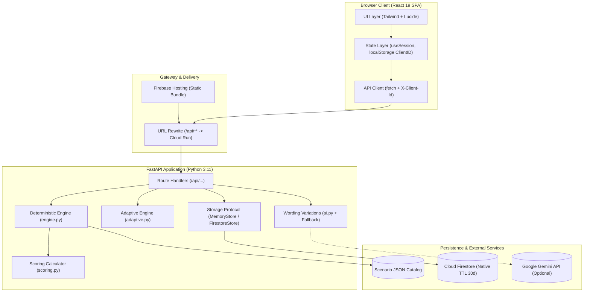

# ScamSim System Architecture & Design

ScamSim is designed as a deterministic, server-authoritative financial fraud simulator. The architecture prioritizes predictable execution, safety boundaries, and tamper-proof scoring.

---

## 1. System Context & Overview

---

## 2. Core Architectural Principles

### 1. Authoritative Server-Side Scoring & State
* **Never Trust the Client**: The browser client receives only sanitized `PublicNode` objects which omit score weights, risk deltas, and red flag lists prior to user submission.
* **Deterministic Execution**: The simulation graph traversal is a pure function of `(scenario, currentNodeId, choiceId)`. Given identical inputs, transitions and results are 100% reproducible.
* **Idempotent Transitions**: Submitting the same choice on a node returns the cached result without duplicate scoring or state corruption.

### 2. Dual Storage Layer (Graceful Cloud Fallback)
* The persistence abstraction (`Store` protocol in `app/store.py`) defines five core operations:
  `get_session`, `put_session`, `get_progress`, `put_progress`, and `delete_client`.
* **FirestoreStore**: Production implementation targeting Google Cloud Firestore collections `sessions` and `progress`, with automatic 30-day expiration (`expiresAt` TTL).
* **MemoryStore**: High-speed, in-memory reference store for unit tests, local development, and automatic failover if cloud credentials or networks are unavailable.

---

## 3. Mathematical Models & Formulas

### 1. Scoring Formula (§12.2)
For an $n$-decision scenario:
* Decision choices carry delta values: $\text{Safe} = +2$, $\text{Cautious} = +1$, $\text{Risky} = 0$, $\text{Critical} = -1$.
* $\text{DecisionScore} = \text{round}\left(100 \times \frac{\max(0, \sum \Delta)}{2n}\right)$
* $\text{FlagScore} = \text{round}\left(100 \times \frac{\text{caught}}{\text{present}}\right)$
* $\text{OverallScore} = \text{round}(0.7 \times \text{DecisionScore} + 0.3 \times \text{FlagScore})$

### 2. Adaptive Learning & Scenario Weights (§13)
* Each learner tracks 5 core competencies clamped in $[0, 100]$ (initial baseline: 50):
  `urgency`, `impersonation`, `payment_verification`, `qr_collect`, `safe_verification`.
* Skills update after each completed session based on performance:
  - Demonstrated skills with positive net delta ($\Delta > 0$): $+10$ to $+20$ points.
  - Missed red flags or risky choices: $-10$ to $-20$ points.
* **Scenario Recommendation Weight Formula**:
  $$w(s) = \frac{\sum_{n \in \text{nodes}} \sum_{c \in n.\text{choices}} |\Delta(s)|}{\text{Total Deltas across all scenarios}}$$
* The engine deterministically targets the user's lowest skill competency. When multiple scenarios train the weakest skill, tie-breaks resolve via category priority, lowest completion count, and alphabetical ID order.

---

## 4. Security & Safety Model

1. **Zero Secret Leakage**:
   - Zero API keys or secrets in frontend bundle or client repository.
   - Enforced by automated CI pre-commit scanner (`scripts/check-bundle.mjs`).
2. **Simulation Sandboxing**:
   - Absolute ban on real payment mechanisms, functional QR patterns, or live banking URLs.
   - Every simulation view displays clear, non-removable `SIMULATION` banners.
3. **Robust Input Validation**:
   - Strict Pydantic models with `extra="forbid"`.
   - Rejection of oversized payloads (>64KB) and invalid client UUIDs.
   - Rate limiting via sliding-window tracker per client ID.
